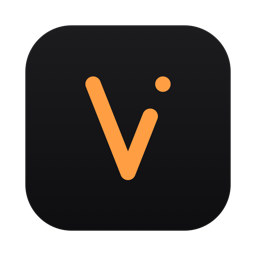
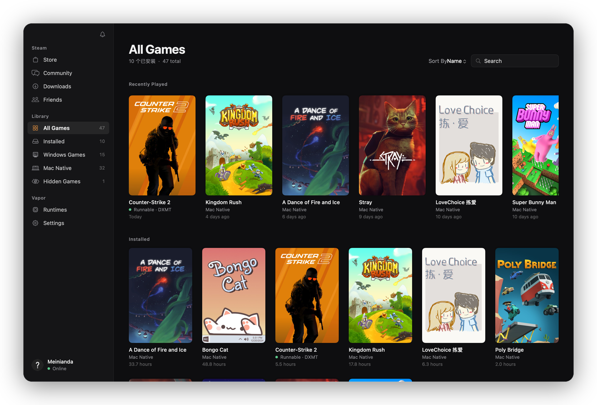
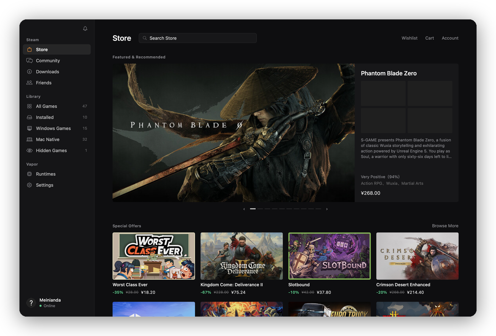
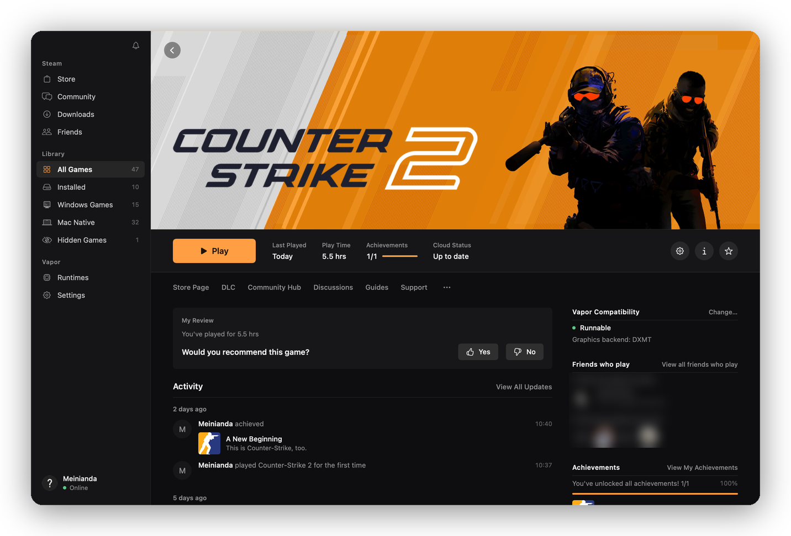
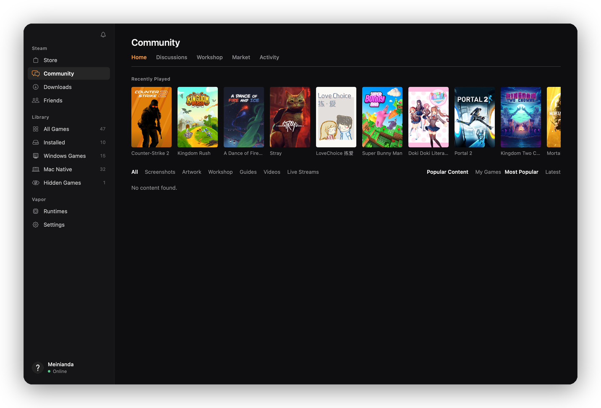
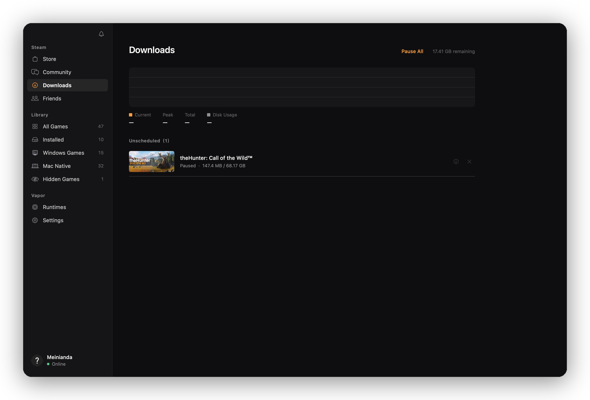
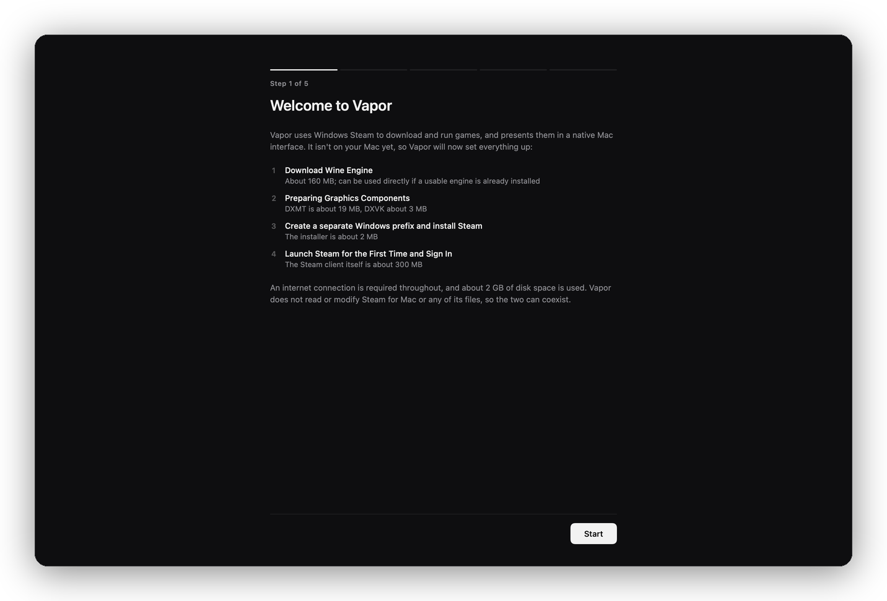
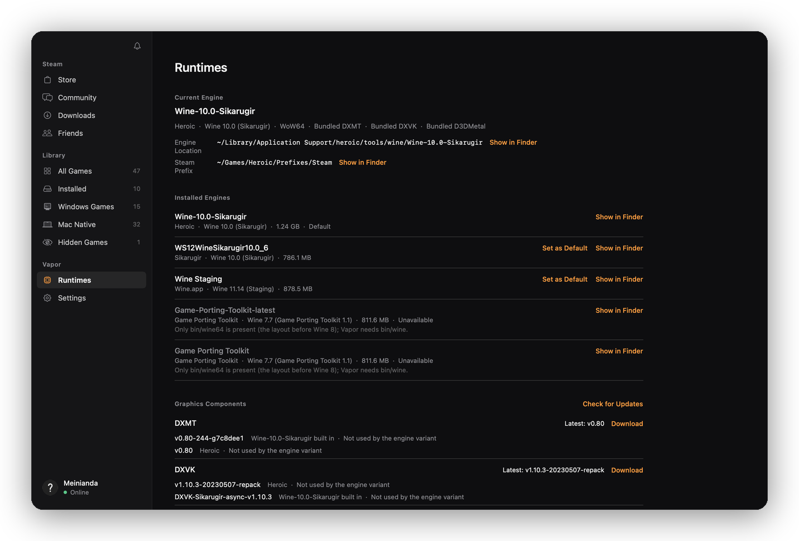
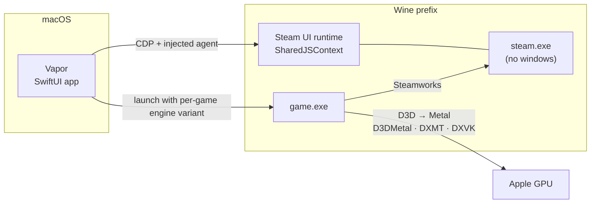

<div align="center">



# Vapor

**Windows Steam games on your Mac, with an interface that feels like it belongs there.**

Vapor runs the real Steam for Windows invisibly in Wine and replaces every one of its windows with native macOS UI:
library, store, community, downloads, friends, sign-in. You never see a Wine window.

[](#requirements)
[](#requirements)
[](Package.swift)
[](#status)

**English** · [简体中文](README.zh-CN.md)



</div>

## Why Vapor

Running Windows Steam on a Mac usually means one of two things: a Wine window that looks like Windows XP and
breaks half the time, or a paid wrapper. Vapor takes a third route.

- **The real Steam does the work.** Downloads, DRM, Steamworks, cloud saves, achievements and friends all come from
  Steam for Windows itself, running headless in a Wine prefix. Nothing is reimplemented or emulated.
- **Vapor draws everything you see.** It talks to Steam's own UI runtime and rebuilds each screen in SwiftUI, using
  Steam's own Chinese and English strings. Steam's windows and dialogs are intercepted and answered from Vapor.
- **Nothing to set up by hand.** On a Mac with no Windows Steam, Vapor downloads Wine and the graphics layers,
  creates the Windows environment, installs Steam and signs you in.

## Features

| | |
|---|---|
| **Library** | Steam's own collections, favourites and hidden games; per-game pages with play bar, activity, achievements, DLC and properties. |
| **Store** | Native front page, search, tags, specials, wishlist, cart and account, fed by the Steam client's signed-in services. Only payment opens Steam's web checkout. |
| **Community** | Hubs, discussions, guides with a reader, workshop, screenshots, inventory, points shop and market. |
| **Downloads** | Steam's queue with per-item pause, progress in the Dock and a notification when a game finishes. |
| **Friends** | Friends list, chat, persona state and notifications. |
| **Accounts** | QR code and password sign-in with Steam Guard, account switching and sign-out, all in Vapor. |
| **Graphics** | Per-game choice of D3DMetal, DXMT, DXVK over MoltenVK or WineD3D, each in its own engine variant. |
| **VaporBoost** | Optional MetalFX upscaling and frame interpolation injected at the Metal layer. |
| **Runtimes** | Install, update and switch Wine engines and graphics layers from inside the app. |

<table>
  <tr>
    <td></td>
    <td></td>
  </tr>
  <tr>
    <td></td>
    <td></td>
  </tr>
  <tr>
    <td></td>
    <td></td>
  </tr>
</table>

## How it works



1. **Headless Steam.** `WindowsSteam` starts Steam for Windows with `-silent` and remote debugging on loopback only.
   A small DYLD shim keeps its Wine processes out of the Dock.
2. **Steam's UI, without its windows.** `SteamUI` holds one Chrome DevTools connection to Steam's
   `SharedJSContext` and injects an agent. The agent reads Steam's stores (apps, downloads, collections, friends,
   settings), calls `SteamClient.*`, and pushes changes to Vapor. It also detaches Steam's own dialog callbacks
   (install wizard, launch questions, cloud conflicts, sign-in) and keeps every popup hidden, so Vapor can answer them.
3. **The store and community over Steam's own connection.** Store, wishlist and cart calls use the protobuf
   services already in Steam's UI bundle, over the client's signed-in connection. Community pages are parsed from
   Steam's public pages and JSON.
4. **A renderer per game.** Vapor analyses each game's executable (graphics API, architecture, anti-cheat) and
   picks a translation layer. Each layer lives in an APFS-cloned variant of the base Wine engine, so switching costs
   almost no disk. Games join Steam's wineserver and get full Steamworks.

## Requirements

- A Mac with Apple Silicon, on macOS 14 Sonoma or later.
- Rosetta 2 (Wine and the graphics layers are x86_64).
- About 2 GB of free space for Wine and Steam, plus your games.
- One Steam client per account: Steam for macOS has to be signed out while Vapor is online, or Steam will sign one of
  them out.

## Install

There are no signed releases yet. Build it from source:

```bash
git clone https://github.com/Meinianda-L/vapor.git
cd vapor
./bundle.sh           # release build → build/Vapor.app
open build/Vapor.app
```

On first launch Vapor walks you through five steps: Wine engine, graphics layers, Windows environment and Steam,
first start, and sign-in. Downloads total about 500 MB.

## Status

Alpha, and moving fast. Things known to work: first-run setup, sign-in, the library, installs and uninstalls through
Steam, downloads, the native store and community, and playing games such as Counter-Strike 2 on DXMT.

Known gaps:

- Games with kernel-level anti-cheat do not run. For EasyAntiCheat and BattlEye titles that allow it, Vapor can start
  the game without anti-cheat for offline play only.
- Games Vapor launches directly skip Steam's cloud sync and first-run installers; launching through Steam is in progress.
- Steam's own Win32 message boxes (for example its self-updater) can still appear.

## Command line

The `vapor` tool drives the same engine without the app, which is handy for debugging:

```bash
swift run vapor engine status         # is Windows Steam up and signed in?
swift run vapor engine ui library     # what Steam's UI runtime reports
swift run vapor wine list             # Wine engines found on this Mac
swift run vapor wine remote           # engines and graphics layers available to download
```

## Building and contributing

```bash
swift build             # VaporKit, the vapor CLI and VaporApp
swift test              # VaporKit tests
Tools/l10n.sh           # refresh the string catalog after changing UI text
.build/debug/VaporApp --snapshot /tmp/shots   # render every screen offscreen to PNG
```

See [CONTRIBUTING.md](CONTRIBUTING.md) for the layout of the code and how to send a change.

| Folder | What it is |
|---|---|
| [`Sources/VaporKit`](Sources/VaporKit) | Engine: Windows Steam in Wine, the Steam UI driver, store and community clients, PE analysis, Wine engines. |
| [`Sources/VaporApp`](Sources/VaporApp) | The macOS app. |
| [`Sources/vapor`](Sources/vapor) | The `vapor` command-line tool. |
| [`Shim`](Shim) | Keeps Steam's Wine processes out of the Dock. |
| [`Boost`](Boost) | VaporBoost: Metal present hook for upscaling and frame interpolation. |
| [`Bridge`](Bridge) | Experimental bridge from Windows games to the native macOS Steam client. |
| [`Resources`](Resources) | App icon and the string catalog. |

## Acknowledgements

Vapor stands on the work of [Wine](https://www.winehq.org), [DXMT](https://github.com/3Shain/dxmt),
[DXVK](https://github.com/doitsujin/dxvk) and [Gcenx's macOS builds](https://github.com/Gcenx/DXVK-macOS),
[MoltenVK](https://github.com/KhronosGroup/MoltenVK), [Sikarugir](https://github.com/Sikarugir-App) and Apple's
Game Porting Toolkit.

Vapor is not affiliated with or endorsed by Valve. Steam and the Steam logo are trademarks of Valve Corporation.
Use Vapor only with games you own.
