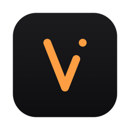
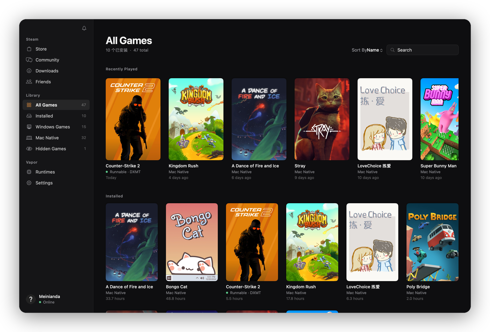
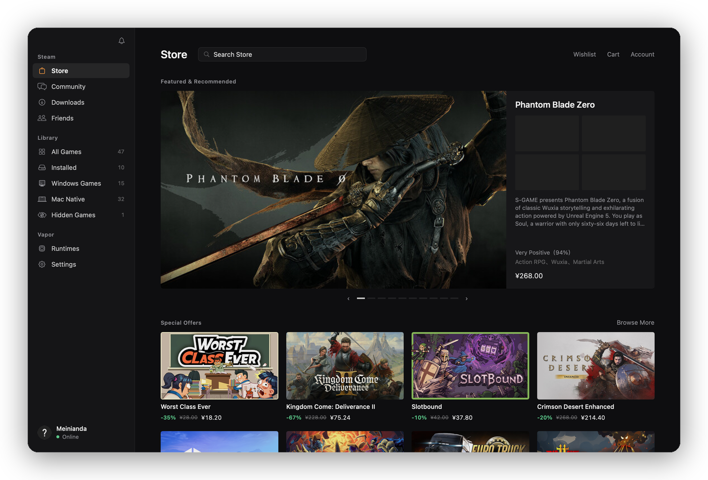
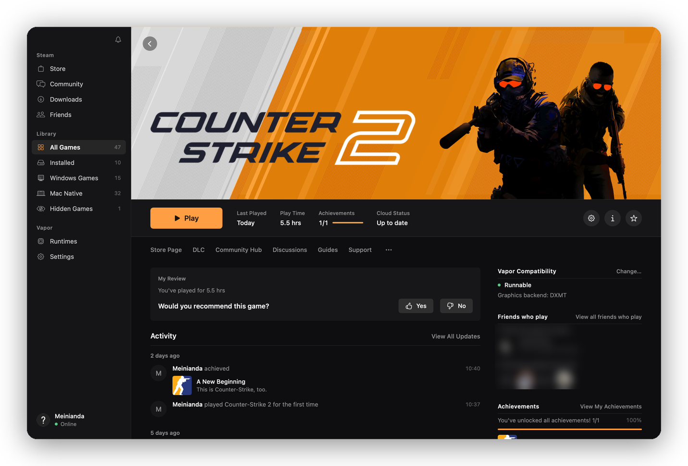
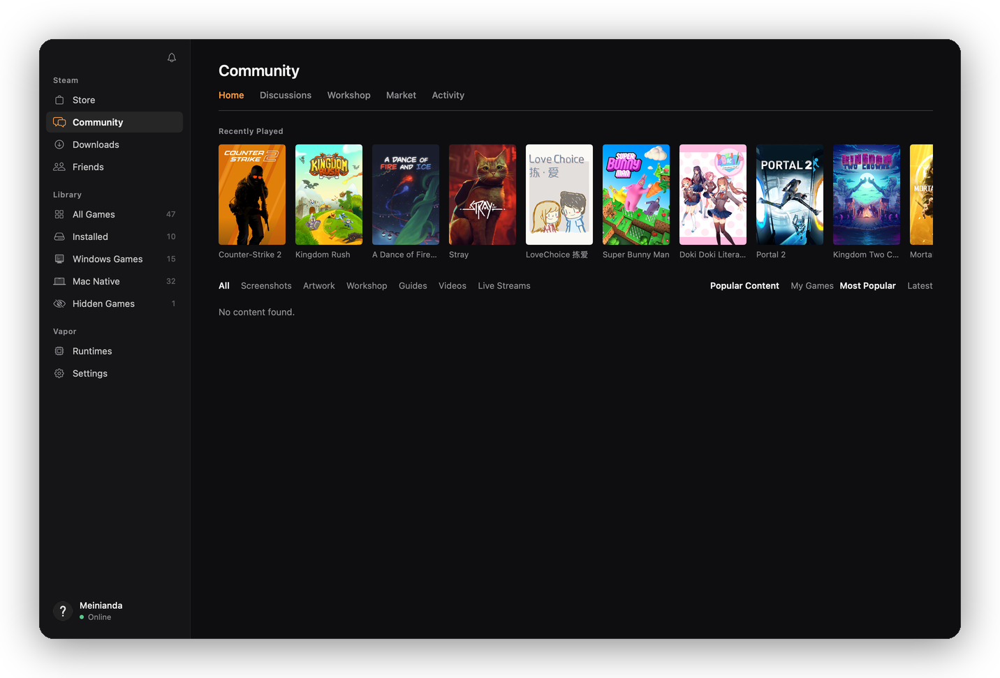
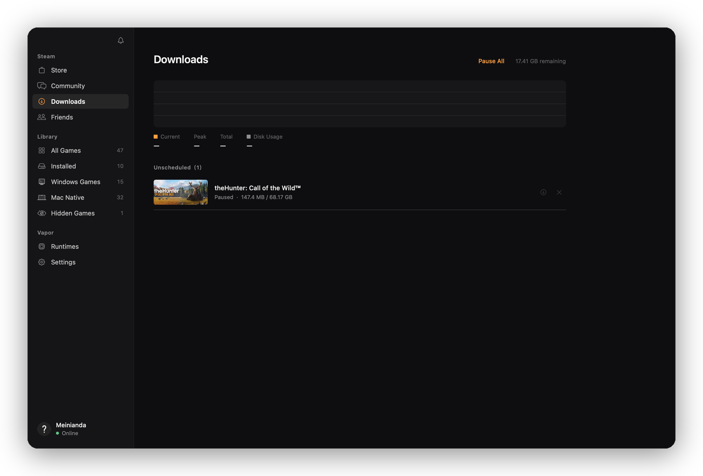
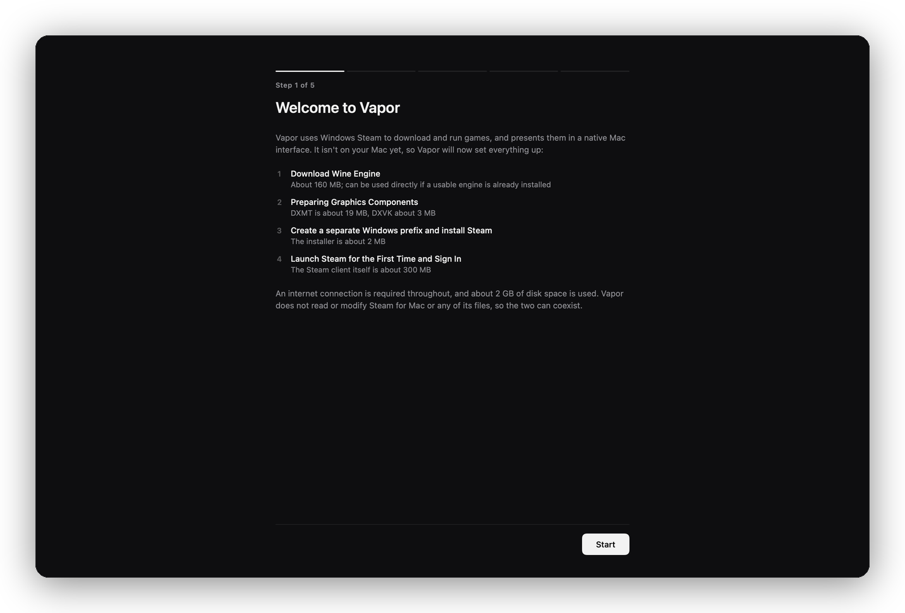
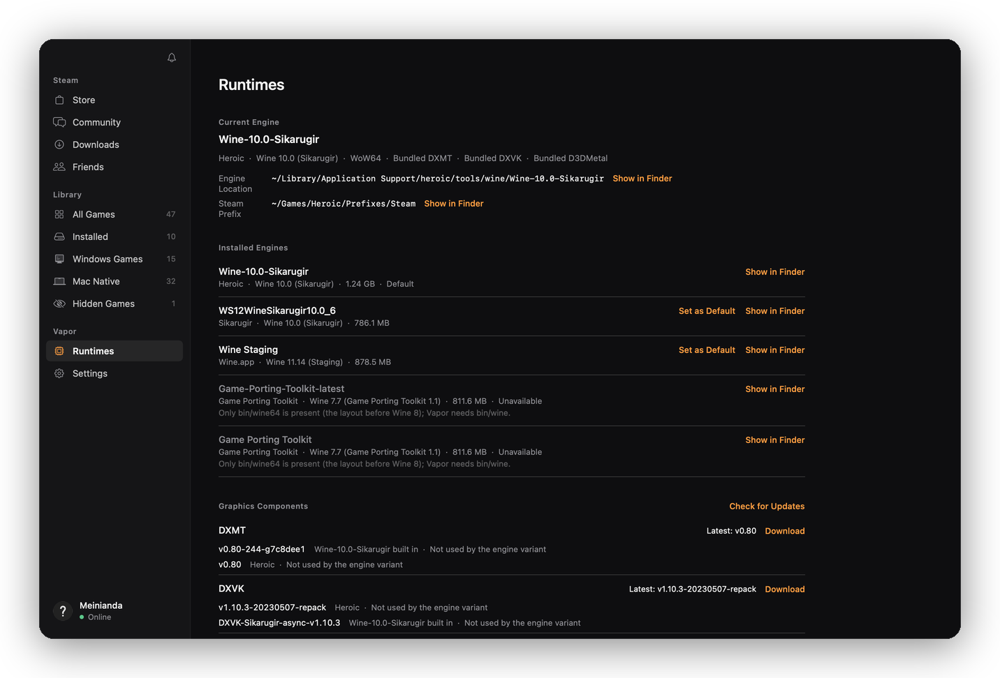
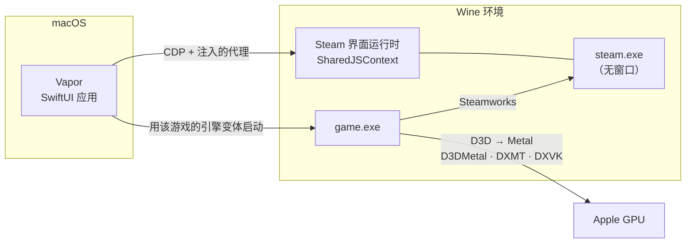

<div align="center">



# Vapor

**在 Mac 上玩 Windows 版 Steam 游戏，界面像原生 Mac 应用一样。**

Vapor 在 Wine 里隐身运行真正的 Windows 版 Steam，再用原生 macOS 界面替换它的每一个窗口：
游戏库、商店、社区、下载、好友、登录。你看不到任何一个 Wine 窗口。

[](#系统要求)
[](#系统要求)
[](Package.swift)
[](#当前状态)
[](LICENSE)

[English](README.md) · **简体中文**



</div>

## 为什么是 Vapor

在 Mac 上跑 Windows 版 Steam，通常只有两种选择：一个看起来像 Windows XP、动不动就出问题的 Wine 窗口，
或者一个付费的封装工具。Vapor 走的是第三条路。

- **真正干活的是 Steam 本身。** 下载、DRM、Steamworks、云存档、成就、好友，全部来自在 Wine 里无界面运行的
  Windows 版 Steam。没有任何东西是重新实现或模拟出来的。
- **你看到的一切都由 Vapor 绘制。** Vapor 连接 Steam 自己的界面运行时，用 SwiftUI 重建每一个界面，文字直接取自
  Steam 自带的中英文字符串。Steam 的窗口和对话框都会被拦下，由 Vapor 来回答。
- **不用手动配置。** 如果 Mac 上还没有 Windows 版 Steam，Vapor 会下载 Wine 和图形组件、创建 Windows 环境、
  安装 Steam，并帮你登录。

## 功能

| | |
|---|---|
| **游戏库** | Steam 自己的收藏夹、收藏和隐藏游戏；每个游戏都有完整页面：开始游戏栏、动态、成就、DLC、属性。 |
| **商店** | 原生的首页、搜索、标签、特惠、愿望单、购物车和账户，数据来自 Steam 客户端已登录的服务。只有付款会打开 Steam 的网页结算。 |
| **社区** | 社区中心、讨论区、带阅读器的指南、创意工坊、截图、库存、点数商店和市场。 |
| **下载** | Steam 的下载队列，可逐个暂停；进度显示在程序坞，下载完成时发送通知。 |
| **好友** | 好友列表、聊天、在线状态和通知。 |
| **账户** | 二维码或密码登录（支持 Steam 令牌），切换账户、退出登录，全部在 Vapor 里完成。 |
| **图形** | 每个游戏可选 D3DMetal、DXMT、基于 MoltenVK 的 DXVK 或 WineD3D，各自使用独立的引擎变体。 |
| **VaporBoost** | 可选的 MetalFX 超分和插帧，在 Metal 呈现层注入。 |
| **运行时** | 在应用里安装、更新和切换 Wine 引擎与图形组件。 |

<table>
  <tr>
    <td></td>
    <td></td>
  </tr>
  <tr>
    <td></td>
    <td></td>
  </tr>
  <tr>
    <td></td>
    <td></td>
  </tr>
</table>

## 工作原理



1. **无界面的 Steam。** `WindowsSteam` 以 `-silent` 启动 Windows 版 Steam，远程调试只监听本机回环地址。
   一个很小的 DYLD 垫片让它的 Wine 进程不出现在程序坞里。
2. **用 Steam 的界面逻辑，不用它的窗口。** `SteamUI` 与 Steam 的 `SharedJSContext` 保持一条 Chrome DevTools
   连接，并注入一个代理。代理读取 Steam 的各个数据存储（应用、下载、收藏夹、好友、设置），调用 `SteamClient.*`，
   把变化推送给 Vapor。它还会接管 Steam 自己的对话框回调（安装向导、启动询问、云存档冲突、登录），并让所有弹窗保持隐藏，
   由 Vapor 来回答。
3. **商店和社区走 Steam 自己的连接。** 商店、愿望单和购物车的请求使用 Steam 界面包里现成的 protobuf 服务，
   通过客户端已登录的连接发出。社区页面解析自 Steam 公开的网页和 JSON。
4. **每个游戏一个渲染器。** Vapor 会分析游戏的可执行文件（图形 API、架构、反作弊），选出合适的转译层。每种转译层放在
   基础 Wine 引擎的一个 APFS 克隆变体里，切换几乎不占磁盘。游戏加入 Steam 的 wineserver，获得完整的 Steamworks。

## 系统要求

- 搭载 Apple 芯片的 Mac，macOS 14 Sonoma 或更新版本。
- Rosetta 2（Wine 和图形组件是 x86_64 代码）。
- 约 2 GB 可用空间给 Wine 和 Steam，另加游戏本身。
- 每个账户同一时间只能有一个 Steam 客户端在线：Vapor 在线时需要退出 Mac 版 Steam，否则 Steam 会让其中一个下线。

## 安装

目前还没有签名的发行版，请从源码构建：

```bash
git clone https://github.com/Meinianda-L/vapor.git
cd vapor
./bundle.sh           # 发布构建 → build/Vapor.app
open build/Vapor.app
```

第一次打开时，Vapor 会带你走完五步：Wine 引擎、图形组件、Windows 环境和 Steam、首次启动、登录。
总共下载约 500 MB。

## 当前状态

Alpha 阶段，迭代很快。目前确认可用：首次运行引导、登录、游戏库、通过 Steam 安装和卸载、下载、原生商店和社区，
以及运行 Counter-Strike 2（DXMT）等游戏。

已知缺口：

- 带内核级反作弊的游戏无法运行。对允许离线游玩的 EasyAntiCheat 和 BattlEye 游戏，Vapor 可以不带反作弊启动，仅限离线。
- 由 Vapor 直接启动的游戏会跳过 Steam 的云同步和首次运行安装程序；通过 Steam 启动正在开发中。
- Steam 自己的 Win32 消息框（比如它的自更新程序）仍可能出现。

## 命令行

`vapor` 命令行工具不经过应用、直接驱动同一套引擎，方便调试：

```bash
swift run vapor engine status         # Windows Steam 是否在运行、是否已登录
swift run vapor engine ui library     # Steam 界面运行时报告的内容
swift run vapor wine list             # 这台 Mac 上找到的 Wine 引擎
swift run vapor wine remote           # 可下载的引擎和图形组件
```

## 构建与参与

```bash
swift build             # VaporKit、vapor 命令行工具和 VaporApp
swift test              # VaporKit 测试
Tools/l10n.sh           # 修改界面文字后刷新字符串目录
.build/debug/VaporApp --snapshot /tmp/shots   # 离屏把每个界面渲染成 PNG
```

代码结构和提交方式见 [CONTRIBUTING.md](CONTRIBUTING.md)。

| 目录 | 内容 |
|---|---|
| [`Sources/VaporKit`](Sources/VaporKit) | 引擎：Wine 里的 Windows Steam、Steam 界面驱动、商店和社区客户端、PE 分析、Wine 引擎管理。 |
| [`Sources/VaporApp`](Sources/VaporApp) | macOS 应用。 |
| [`Sources/vapor`](Sources/vapor) | `vapor` 命令行工具。 |
| [`Shim`](Shim) | 让 Steam 的 Wine 进程不出现在程序坞。 |
| [`Boost`](Boost) | VaporBoost：用于超分和插帧的 Metal 呈现钩子。 |
| [`Bridge`](Bridge) | 实验性：让 Windows 游戏直接连接 Mac 版 Steam 客户端的桥接。 |
| [`Resources`](Resources) | 应用图标和字符串目录。 |

## 许可证

Vapor 以 [MIT 许可证](LICENSE) 发布。它下载的 Wine、DXVK、DXMT、MoltenVK 等组件各自沿用自己的许可证。

## 致谢

Vapor 建立在这些项目之上：[Wine](https://www.winehq.org)、[DXMT](https://github.com/3Shain/dxmt)、
[DXVK](https://github.com/doitsujin/dxvk) 与 [Gcenx 的 macOS 构建](https://github.com/Gcenx/DXVK-macOS)、
[MoltenVK](https://github.com/KhronosGroup/MoltenVK)、[Sikarugir](https://github.com/Sikarugir-App)，以及 Apple 的
Game Porting Toolkit。

Vapor 与 Valve 没有任何关联，也未获其认可。Steam 及 Steam 标志是 Valve Corporation 的商标。
请只用 Vapor 运行你拥有的游戏。
